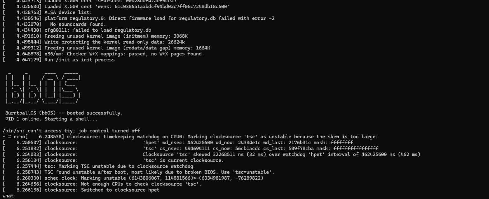

# BurntballOS (bbOS)



bbOS is an experimental x86-64 Linux system with a small C init process, BusyBox
userland, and `bbpkg`, a minimal package installer. This repository contains the
project's source and build instructions. Generated compilers, downloaded upstream
sources, kernels, root filesystems, binaries, and logs are excluded from Git.

## What is included

- `init.c`: PID 1 mounts `/proc`, `/sys`, and `/dev`, starts a console shell,
  reaps children, and restarts the shell with a one-second delay.
- `bbpkg.c`: installs trusted `.tar.gz` packages and records their file lists;
  supports `install`, `remove`, `list`, and `info`.
- `build-bbos-toolchain.sh`: bootstraps binutils 2.42, GCC 13.2.0, glibc 2.39,
  Linux 6.6.21, BusyBox 1.36.1, and the bbOS programs into a local sysroot.
- `Makefile` and `tests/`: warning-clean local builds and isolated package tests.

This is a development prototype. The pinned upstream versions are old and should
be reviewed before any network-facing deployment. There is no graphical desktop,
login system, installer, dependency resolver, or complete distribution image.

## Quick local build and checks

On a Linux host with a C compiler, GNU Make, Bash, Python 3, and tar:

```sh
git clone https://github.com/jajajajadux-spec/bbOS.git
cd bbOS
make
make check
```

Executables are written to `build/`. Tests compile a separate package installer
whose root is a temporary directory, so they do not install packages onto the host.
`build/init` refuses to run unless it is PID 1. Run it in the VM below.

## Tutorial: build and start bbOS in QEMU

Use an x86-64 Debian/Ubuntu Linux machine or VM with plenty of disk space and time
for a full compiler build. Run the build as an ordinary user; use `sudo` only to
install host dependencies.

### 1. Install host tools

```sh
sudo apt-get update
sudo apt-get install -y build-essential bison flex texinfo gawk wget curl \
  python3 rsync xz-utils bzip2 gzip bc libncurses-dev libelf-dev libssl-dev \
  libgmp-dev libmpfr-dev libmpc-dev libisl-dev file cpio qemu-system-x86
```

### 2. Build the cross toolchain, kernel, and userland

From the cloned repository:

```sh
# Optional: limit parallelism to reduce peak memory use.
export JOBS=4
export BB_ROOT="$HOME/bbos-build"
./build-bbos-toolchain.sh > build.log 2>&1
```

Watch progress from another terminal with `tail -f build.log`. The script stops
on failed steps. Read the log before rerunning; existing source/build directories
are reused. Downloads use HTTPS but are not cryptographically verified by this
script. Obtain and verify upstream signatures/checksums before a release build.

Successful output includes:

```text
$BB_ROOT/tools/bin/x86_64-bbos-linux-gnu-gcc
$BB_ROOT/bbos-kernel
$BB_ROOT/sysroot/init
$BB_ROOT/sysroot/usr/bin/bbpkg
$BB_ROOT/sysroot/bin/busybox
```

The complete bootstrap has not been rerun from scratch as part of this revision.
The C programs were compiled using an existing cross toolchain, and the minimal
image was tested with the existing kernel and BusyBox.

### 3. Assemble a minimal RAM root filesystem

Keep using the same terminal with `BB_ROOT` set. These commands copy only the
static runtime programs into a fresh staging directory under `build/`:

```sh
export BB_ROOT="${BB_ROOT:-$HOME/bbos-build}"
ROOTFS="$(mktemp -d "$PWD/build/rootfs.XXXXXX")"
mkdir -p "$ROOTFS"/{bin,dev,proc,sys,tmp,usr/bin,var/lib/bbpkg/installed}
cp "$BB_ROOT/sysroot/init" "$ROOTFS/init"
cp "$BB_ROOT/sysroot/usr/bin/bbpkg" "$ROOTFS/usr/bin/bbpkg"
cp "$BB_ROOT/sysroot/bin/busybox" "$ROOTFS/bin/busybox"
chmod 0755 "$ROOTFS/init" "$ROOTFS/usr/bin/bbpkg" "$ROOTFS/bin/busybox"
chmod 1777 "$ROOTFS/tmp"
for applet in sh ls cat mount mkdir uname poweroff reboot tar echo sleep dmesg; do
  ln -s busybox "$ROOTFS/bin/$applet"
done
(cd "$ROOTFS" && find . -print0 | cpio --null -o --format=newc) \
  | gzip -1 > build/initramfs.cpio.gz
```

The bootstrap builds init, bbpkg, and BusyBox statically; this minimal image does
not require copying shared libraries. If you compiled the programs yourself,
rebuild with `make clean && make CC="$BB_ROOT/tools/bin/x86_64-bbos-linux-gnu-gcc" LDFLAGS=-static`
and copy `build/init` and `build/bbpkg` instead.

### 4. Start the VM

```sh
qemu-system-x86_64 \
  -m 256M \
  -kernel "$BB_ROOT/bbos-kernel" \
  -initrd build/initramfs.cpio.gz \
  -append 'console=ttyS0 rdinit=/init panic=1' \
  -nographic -no-reboot
```

Wait for the bbOS message and shell prompt. Try:

```sh
uname -a
ls /
bbpkg list
exit
```

`exit` restarts the shell. Quit QEMU by pressing **Ctrl+A**, then **X**.
This image runs from RAM: package installations and filesystem changes disappear
when the VM stops. No host disk is attached by these commands.

If `/init` cannot execute, check its permissions and confirm `file` reports a
static x86-64 binary. A custom kernel needs initramfs/gzip, ELF, devtmpfs, procfs,
sysfs, and a serial console enabled. The commands above use the standard kernel
defconfig from the bootstrap.

## Using bbpkg

Run mutating commands as root **inside bbOS**. For example, on the build host,
create a package containing paths relative to `/`:

```sh
mkdir -p build/example/usr/local/bin
printf '#!/bin/sh\necho Hello from bbOS\n' > build/example/usr/local/bin/hello
chmod +x build/example/usr/local/bin/hello
tar -czf build/hello-1.0.tar.gz -C build/example usr
```

Copy the archive into `$ROOTFS/tmp/` and repeat the archive creation and QEMU
steps. In the VM:

```sh
bbpkg install hello /tmp/hello-1.0.tar.gz
bbpkg list
bbpkg info hello
/usr/local/bin/hello
bbpkg remove hello
```

Package names must start with an alphanumeric character, contain only letters,
numbers, `.`, `_`, `+`, or `-`, and be at most 128 characters long. Manifests live
under `/var/lib/bbpkg/installed`. Installation/removal operations use a lock.
Removal handles children before parents and leaves nonempty shared directories.

Install only trusted, locally reviewed archives. Path checks reject traversal and
existing symlink parents, but tar extraction is not a sandbox: archive link
metadata, changes between listing and extraction, and concurrent filesystem
changes are outside this prototype's protection. The package format uses one path
per line; filenames with newlines are unsupported. Packages may overwrite existing
files; there is no ownership-conflict resolution or rollback of extracted files.
Removing such a package can remove those files. Use disposable VMs for testing.

## License and attribution

Original bbOS code is licensed under the BSD 3-Clause license in `LICENSE`.
You may use, modify, and redistribute it while retaining the copyright notice,
license conditions, and disclaimer. Binary redistributions must carry those
notices in accompanying documentation/materials. Credit `jajajajadux-spec` and
retain the project attribution when redistributing this code.

Linux, BusyBox, GCC, glibc, binutils, and their dependencies keep their own licenses.
The bbOS license does not replace those upstream licenses. Distributing a built
system requires meeting the applicable upstream license obligations as well.
